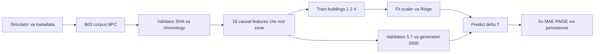

# Đối chiếu main, B01–B03 và chuẩn bị B04 — 25/11/2026

Chẩn đoán tiếp26/11: xem `B04_DIAGNOSTICS.md/json` cho frozen-model residual,
action coverage và readback phase. Không refit hoặc bật B05; các kết quả bên
dưới là lịch sử của baseline ban đầu và DEV-SMALL, không đổi thành thử model mới.

**Đọc trạng thái mới nhất trước:** mục “B delivery / DEV-SMALL — 26/11/2026”
ở cuối và `DEV_SMALL_RESULTS.json` đã đủ 15/15 full cases. Những mục PARTIAL,
NOT RUN DEV-SMALL, 158 tests và “không push” bên dưới là snapshot phiên trước,
được giữ làm lịch sử; không phải trạng thái mới nhất hoặc hạn chế mới.

## Kết luận hiện có

Main `3dd6b3a850354ea1eddfe58b9c8d2926f48bff31` thêm đúng 5 file A trong team/.
Không đổi simulator, evaluator, scorer hay scenario chính thức so với nền B
`78d8b62`. Upstream main cũng được đối chiếu trực tiếp: vẫn ở `1fb75606`.
Do đó không cần thu lại dataset B03 chỉ vì thêm code A. Corpus giữ nguyên
provenance; không tự thay source SHA lịch sử bằng SHA main hiện tại.

Đã đọc lại bản trích xuất của 00/01/02/04/06 FINAL v2.1, mở PDF gốc và kiểm tra
số trang/hash. COMMON_CONTRACT cho phép tool/config/test/experiment ngoài team/;
giữ layout B đã giải thích trong team/README.md tránh di chuyển hàng loạt.

B01 runtime audit mới ở hai building đạt unit/chronology assertions. Dictionary
807 dòng vẫn đại diện hai building; metadata B03 mới cung cấp mapping đầy đủ
theo từng episode. B01 chưa chứng minh tính hợp lý vật lý của mọi sensor/tail.
Đặc biệt sensor lag khác với command application lag: action được gửi trước
simulation advance nhưng sensor VAV cập nhật trước solve. B04 dùng action trước
và delta sensor quá khứ; không đọc physical state ẩn hoặc obs tương lai.

B03 offline validation: 6 full episodes, 51,840 transitions, 3,568,320 zone labels;
không dropped rows. Xem artifacts/B03-main-validation.json để có counts thật.
Generated B02 trên Windows: đã thêm `prepare_scenarios.py`, tái dùng phép đổi
đường dẫn whitelist từ B03 và redirect metrics vào workspace mới. Smoke thực
building_0500/atlanta_4 qua runner B02 với `--scenarios-dir` đã SUCCEEDED_SMOKE,
288 bước, 98.734 giây. Scorer từ chối run này với exit=2 vì không phải full.
Nguồn generated giữ nguyên; receipt ghi hash original/effective. Default chạy
trực tiếp config có backslash vẫn không nên dùng; full generated suite NOT RUN.
Trong 98.7 giây smoke có job Base chạy đồng thời do bước chờ CIM bị từ chối quyền;
peak 2 simulator processes, mỗi job 1 worker/1 thread. Không giả log thành hoàn
toàn tuần tự; các lượt benchmark Base vẫn tuần tự với nhau.
Sau review, smoke v2 trỏ floor plan/zone map tới đúng bản sao đã hash cũng đạt
288 bước, 87.894 giây, chạy sau khi toàn bộ Base jobs đã dừng. Scorer v2 trả
exit=2 như mong đợi. Bằng chứng nằm ở generated-portable-smoke-20261125-v2.

## Hợp đồng và Base

Setpoint heating/cooling trong observation là raw Kelvin; A đọc trực tiếp đúng.
Nhiệt độ zone có normalizer mean=295, std=5: observation -0.2 ứng với 294 K.
Fixture A chỉ ghi VAV slots, giữ discrete và plant slots; tuy nhiên adjust sửa
action input, vi phạm yêu cầu bản sao. Cần A sửa và test identity khi disabled.
Chưa có composer/cờ enable_a chung; _command_zones ghi tất cả zones mỗi lần
được gọi cho một AHU (dư thừa, cần review runtime cho building lớn).

pid_water có nguồn Apache-2.0 từ starter kit, chạy offline, mapping metadata và
hook _command_zones cho A. So với pid, nó thêm worst-zone AHU demand, economizer,
reheat tỷ lệ, water-temperature reset và dùng setpoint sensors. Đây là lý do kỹ
thuật phù hợp làm fallback; không chứng minh nó tốt nhất cho mọi building.
Trong ngân sách phiên này, chỉ đo pid, pid_water và member_a. Các policy official
bang_bang/fixed_setpoint/all_off/transfer chưa được đo lại; không gán thứ hạng
cho các ứng viên đó từ snapshot cũ.
Member A là `pid_water + zone logic A`, không phải một Base độc lập. Giữ pid
làm đối chứng mạnh; trước khi chốt nền cuối có thể đề nghị A thử cùng zone logic
trên pid và pid_water để tách lợi ích module khỏi lựa chọn plant base. Chưa chạy
ablation này trong phiên; không tự đổi nền của teammate.
Không lấy 0.054/0.067 trong nhật ký hoặc shipped baseline_returns làm điểm đo mới:
diagnostic cũ cho thấy khác phiên bản simulator. So sánh bằng cùng SHA/config.

Hai public notebook trong Master Plan đã được mở lại nhưng không lấy được nội
dung source/license/version có thể kiểm chứng qua giao diện đọc hiện tại. Chúng
vẫn là ứng viên NOT VERIFIED; chưa sao chép, chạy hay gán điểm tác giả cho nhóm.
G1 vẫn cần base lock, license/reproduction matrix, generated validation và bằng
chứng Kaggle G0/G1 từ C. Commit ghi 'chốt Base' không thay thế các bằng chứng đó.

Fairbanks full đã tái hiện số nhật ký: pid=-1362.922295, pid_water=-2607.412791,
member_a=-1270.554612. Nhưng giải thích cơ chế phải theo component thật:
weighted comfort loss của pid_water khoảng 807.010, A khoảng 803.628; weighted
energy 710.057 -> 171.994, weighted carbon 1090.345 -> 294.933. Khoảng 99.75%
phần giảm loss của A so với pid_water đến từ energy+carbon; chưa có bằng chứng
từ tổng reward rằng cải thiện chủ yếu do phòng ấm nhanh. So với pid, A còn có
comfort loss cao hơn nhưng tổng loss thấp hơn nhờ energy/carbon. Cần giữ cả bảng
component, không chỉ trích score đẹp hoặc chỉ nhìn comfort. Các component dùng
đúng dấu từ reward source: `loss = -0.6*productivity_regret + 0.2*energy + 0.2*carbon`.

## B04 đã thực hiện

Một mô hình Ridge alpha=1 cố định, 16 features nhân quả ánh xạ bằng metadata,
1,537,920 train zone-transitions từ buildings 1/2/4. Mean/std và coefficients chỉ
fit train. Validation 5/7 và generated-dev 0500 chỉ predict. Persistence ΔT=0 là
đối chứng. Giữ nguyên tails, không clipping hay chọn bỏ sample để làm đẹp số.
Model NPZ không pickle, reload và so sánh dự đoán bằng nhau tuyệt đối. Tests có
đối chiếu implementation Ridge với sklearn, chặn nonfinite và kiểm tra x[t]
không thay đổi khi sửa observation tương lai, reward hoặc building diagnostic ID.

| Building / split | Persistence MAE K | Ridge MAE K | Persistence RMSE K | Ridge RMSE K |
|---|---:|---:|---:|---:|
| 5 / validation Atlanta | 0.46315 | 0.43496 | 1.04359 | 0.91699 |
| 7 / validation Singapore | 0.58538 | 0.55317 | 1.08930 | 0.95524 |
| 0500 / generated-dev Atlanta | 0.29690 | 0.33657 | 0.53771 | 0.49187 |

MAE validation gộp theo số sample: 0.50141 -> 0.47196 (giảm khoảng 5.87%).
Generated MAE xấu hơn khoảng 13.36%, dù RMSE tốt hơn. Ridge tối ưu squared error
nên có thể cải thiện lỗi lớn mà tăng lỗi điển hình; cần xem per-zone/tails, không
coi đây là nghịch lý. Chỉ 1 weather/building nên climate và geometry bị confound.
Không tune theo generated-dev đã xem; lần nghiên cứu tiếp phải ghi rõ tập này
đã được dùng làm development evidence, tuyệt đối không gọi là final holdout.

## Hướng tối ưu tiếp có bằng chứng

1. G1: sửa interface A, khóa fallback pid_water nếu public candidates chưa tái
   hiện; C cung cấp Kaggle acceptance/runtime. Đánh giá Base và A trên đủ 5 khí
   hậu cùng generated-dev trước khi bật mặc định.
2. Phân rã loss comfort/energy/carbon từ summary, xếp các scenario/zone gây loss
   lớn; thay từng cơ chế, tránh tune chỉ Fairbanks. Dùng paired ablation, giới
   hạn 8–10 trial nhỏ cho C trước khi mở rộng; không quét mọi tham số đồng thời.
3. B04 tiếp: kiểm tra residual theo zone/temperature band và sensor phase; bổ
   sung weather/plant-observed features bằng thiết kế mới, đánh giá trên validation.
   Có thể tăng số climate trên mỗi train building để giảm confounding, trong
   ngân sách đã đo; không thu lại toàn bộ corpus chỉ để đổi tên Base.
4. B05 chỉ triển khai discrete scheduling có fallback sau khi predictor đủ dùng.
   So BASE với BASE+B trên cùng kịch bản full. MAE tốt không tự tạo HVAC gain;
   nếu không cải thiện control, giữ ML offline và tắt B.
5. G2 thử tối đa 2–3 tổ hợp A/B/C có lý do. Giữ Safe; frozen holdout chỉ mở một
   lần theo quyết định nhóm. Không có bảo đảm đạt điểm hoặc thứ hạng cao nhất.

Các kết quả Base full, kiểm thử cuối và NOT RUN của phiên nằm cuối file.
Không có push/PR/merge/submission trong phiên.

Runner đối chứng đã kết thúc sau 2400.299 giây, 5/6 full cases. A/Phoenix chỉ
được cấp phần ngân sách còn lại 333 giây nên TIMED_OUT; các lượt Phoenix trước
mất khoảng 459–462 giây. Không coi timeout này là chứng minh policy treo/chậm
hơn, và không chấm episode dở dang. Receipt/log lỗi được giữ nguyên. Historical
parent đã nạp source driver trước hai review fixes; archive source đầu tiên vẫn
còn trong first run. Audit cuối kiểm tra đủ expected cases độc lập, không sửa
receipt lịch sử thành thành công. Driver hiện tại có status/expected/missing và
exit khác 0 khi thiếu job/budget. Unit tests đã chứng minh hành vi mới.

## Giải thích để tự trình bày

Luồng dữ liệu: simulator -> observation + metadata -> B03 NPZ -> validator ->
per-zone feature table -> train-only scaler -> Ridge -> predicted ΔT -> metrics.
B04 kết thúc ở dự báo/đánh giá; chưa nối đường dự báo vào action của HVAC.



`audit_main.py` kiểm tra code mới và fixture quyền ghi của A. `forecast.py` đọc
corpus đã kiểm chứng, lấy cùng 16 loại thông tin cho mỗi zone, fit hệ số bằng
train rồi đo ở các split còn lại. `compare_bases.py` chỉ điều phối runner B02
và đăng ký policy A qua wrapper sẵn có; không viết lại evaluate.py hay reward.
NPZ giữ arrays/model số; JSON giữ mô tả, SHA và trạng thái; CSV tiện đọc bảng;
PNG là biểu đồ có thể dùng giải thích, không phải bằng chứng tăng điểm control.

Input mỗi episode gồm observation `(8641,D)`, action `(8640,C)` / `(8640,K+1)`
và target `(8640,Z)`. D/C/K/Z thay đổi theo building; metadata giải quyết mapping.
Sau khi lấy từng zone, X luôn có 16 cột, y là một cột ΔT. Model lưu 16 hệ số,
16 mean, 16 scale và một intercept; không lưu building ID làm hệ số riêng.

| Nhóm feature | Số cột | Đơn vị / phạm vi |
|---|---:|---|
| Nhiệt độ zone hiện tại | 1 | Kelvin gốc |
| Delta sensor đã quan sát trước đó | 1 | Kelvin |
| Khoảng cách tới heating/cooling band | 2 | Kelvin |
| Damper/reheat được chọn tại t và t-1 | 4 | Command normalized [-1,1] |
| AHU supply/pressure command tại t | 2 | Command normalized [-1,1] |
| AHU on tại t và t-1 | 2 | 0/1 |
| sin/cos giờ và thứ | 4 | [-1,1] |

Ở reset không có lịch sử, các feature trước đó dùng zero cố định; đây là quy
ước cần giữ khi inference. Những command đó là yêu cầu đã chọn, không phải
cam kết actuator vật lý đã đạt đúng ngay trong bước.

Một hàng học: ở thời điểm t zone đang 294 K, action base đã chọn và action trước
đều biết được. Sau bước mới cảm biến báo 294.1 K thì label là +0.1 K. Persistence
dự đoán 0 nên sai 0.1 K. Ridge dự đoán +0.07 thì sai 0.03 K ở hàng đó. Dùng
294.1 K làm feature để dự đoán chính nó sẽ là leakage. Để cùng building xuất hiện
trong train và validation cũng có thể làm kết quả trông tốt do ghi nhớ layout.

Có hai phép chuẩn hóa khác nhau: metadata chính thức biến normalized observation
về đơn vị gốc; scaler ML học mean/std từ train để đưa các cột về thang tương đương.
Ví dụ `(normalized=-0.2)*5 + 295 = 294 K`, tức khoảng 20.85 °C. Hằng số chính thức
được cung cấp hợp lệ cho từng building; scaler ML tuyệt đối không fit lại bằng
toàn bộ dữ liệu validation/generated. Kelvin dùng cho nhiệt độ tuyệt đối, còn
chênh lệch 0.1 K cũng bằng chênh lệch 0.1 °C.

Ví dụ chạy trong Python của dự án, không cần simulator:

```python
import numpy as np
from team_tools.forecast import fit_ridge, predict
x = np.array([[0.], [1.], [2.], [3.]])
y = np.array([0., .1, .2, .3])
model = fit_ridge(x, y, alpha=1.)
print('Train mean:', model['mean'])
print('Predicted delta K:', predict(model, np.array([[1.5]])))
```

Regularization alpha làm hệ số bớt lớn, giảm xu hướng bám sát quá mức train.
Nó không bảo đảm transfer: physics, climate, sensor phase và action distribution
của building mới có thể khác. Vì vậy ta giữ persistence, bảng từng building và
fallback. Muốn chứng minh tăng điểm HVAC phải chạy policy BASE+B đủ episode,
không thể suy từ riêng ví dụ dự đoán hoặc MAE.

## Bằng chứng cuối phiên

158 passed, 15 warnings, 29 subtests passed in 86.97s (0:01:26)

| Scenario | Policy | Total reward / 8640 steps | Loss per step |
|---|---|---:|---:|
| building_train_1/fairbanks_1 | member_a | -1270.554612 | 0.14705493 |
| building_train_1/fairbanks_1 | pid | -1362.922295 | 0.15774564 |
| building_train_1/fairbanks_1 | pid_water | -2607.412791 | 0.30178389 |
| building_train_4/phoenix_8 | pid | -262.787165 | 0.03041518 |
| building_train_4/phoenix_8 | pid_water | -261.278116 | 0.03024052 |

Status: PARTIAL_DIAGNOSTIC. Không phải suite score hay điểm Kaggle.

CPU-core-hours đã đo: 0.607222. Base jobs sequential. Generated smoke overlapped one Base job ~99s after CIM scheduling check failed. Peak 2 simulator processes, 1 worker/thread per process.

NOT RUN: Full five-climate DEV-SMALL, DEV-FULL 30, Full generated-dev 20, Frozen holdout, Other official policies: bang_bang/fixed_setpoint/all_off/transfer, Public candidate code/license reproduction, Kaggle acceptance/submission, B05 controller, Predictive control score, Jupyter kernel startup, Human A/C signoff.

Danh sách file mới/sửa so với checkout B gốc, SHA và mọi job receipt: artifacts/session_results.json.

## Tiếp tục G1 — 26/11/2026

Đã chạy bù A/Phoenix đủ 8640 bước với ID mới; timeout cũ và báo cáo 5/6 ngày 25/11 giữ nguyên.

| Policy | Fairbanks loss | Phoenix loss | Mean of these 2 cases |
|---|---:|---:|---:|
| pid | 0.15774564 | 0.03041518 | 0.09408041 |
| pid_water | 0.30178389 | 0.03024052 | 0.16601221 |
| member_a | 0.14705493 | 0.03108700 | 0.08907097 |

Loss = abs(total_reward/8640), thấp hơn tốt hơn. Mean chỉ gồm 2 case đã khóa, không phải suite/Kaggle score.

Run mới: base-resume-20261126-phoenix-member_a; reward=-268.59168894; wall=468.160s; CPU=0.124722 core-hours.

G1: PREPARED_FOR_HUMAN_REVIEW, chưa APPROVED. Cần A sửa copy/flag contract, xác nhận đủ 5 khí hậu/generated-dev, A/C base lock và C đưa bằng chứng Kaggle. Không tự tạo base lock hoặc ký thay nhóm.

B04 giữ nguyên model và split. Không fit mới theo generated-dev đã xem, chưa bật B05. Nghiên cứu tiếp residual/sensor phase và validation trước khi thử control.

Bằng chứng mới: artifacts/base_review_20261126.json. Tests 158+29 là kết quả phiên trước; hôm nay chỉ bổ sung run và kiểm tra SHA/config/steps/components bằng assertions trong script báo cáo. Không push/PR/merge.

Diễn giải để chọn hướng tối ưu: A có mean 2-case thấp nhất (0.08907097), nhưng Phoenix loss cao hơn pid_water 2.799%. Ở Phoenix, weighted comfort loss tăng 247.78475 -> 255.73175; energy+carbon chỉ giảm khoảng 0.63342, nên tổng loss tăng 7.31357 reward-units. Giảm năng lượng không đủ bù phần comfort tăng. Chưa thể xác định thiếu sưởi/quá nóng từ tổng này; cần xem log theo zone/thời điểm trước khi đổi gain/van.

Đề xuất làm tiếp theo ownership: A sửa no-input-mutation và flag-off identity, rồi phân tích Phoenix bằng observation hợp lệ; B ưu tiên đủ DEV-SMALL năm khí hậu trước generated-dev theo budget; C cung cấp Kaggle Safe/G0 và G1 acceptance/runtime, cùng A khóa Base/fallback. Giữ pid làm đối chứng mạnh, giữ member_a làm candidate. Không hardcode weather/building ID hoặc bật module dựa riêng vào mean của hai case. B04 tiếp tục là offline research; mô hình Ridge hiện chưa đủ bằng chứng để bật B05.

## B delivery / DEV-SMALL — 26/11/2026

Fresh source: 179 passed, 15 warnings, 34 subtests passed in 87.10s (0:01:27). No generated data or model in fresh tree; installed environment reused. Nine notebook code cells verified in fresh Python; Jupyter kernel NOT RUN.

Source/AI/time disclosure: PROJECT_KNOWLEDGE.md. Person-hours NOT RECORDED; no inference from commits/wall/CPU. Raw paths/receipts retained locally; public path exports are portable copies.

| Policy | DEV-SMALL mean loss (5 full cases) | Worst loss |
|---|---:|---:|
| pid | 0.06947283 | 0.15774564 |
| pid_water | 0.08769696 | 0.30178389 |
| member_a | 0.05414362 | 0.14705493 |

Metrics are equal-weight local five-case scores; not DEV-FULL/generated/Kaggle. Preserve per-case regressions when selecting a candidate.

G1 NOT APPROVED. Merge of B infrastructure/research does not enable B05, fix A policy, or replace A/C signoff. No holdout/Kaggle action performed.
